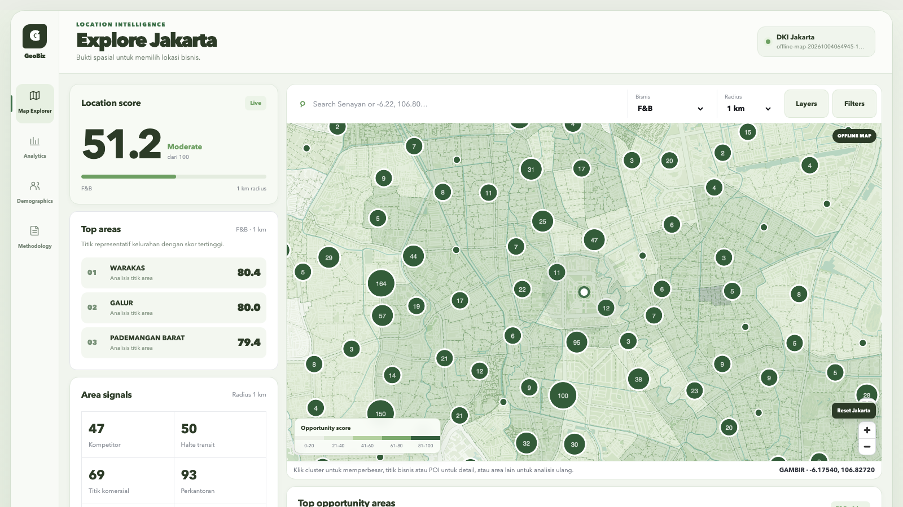

# GeoBiz

GeoBiz is a DKI Jakarta business-location intelligence dashboard for the umbrella
categories **F&B**, **Retail**, and **Services**. It combines traceable public
datasets with transparent, versioned scoring. Demo records are real businesses
from OpenStreetMap; synthetic data is restricted to isolated automated tests.



[Watch the 38-second demo](showcase/geobiz-demo.mp4) ·
[Watch the 11-second Map Explorer filters demo](showcase/geobiz-map-filters-demo.mp4) ·
[Analytics screenshot](showcase/02-analytics.png) ·
[Demographics screenshot](showcase/03-demographics.png)

The screenshots and video were captured from the running application using
its active, locally stored dataset. They are not design mockups. Population is
an official 2025 kelurahan aggregate, not a claim about individual customers.

The v2 application includes:

- an offline-first MapLibre map served from a release-scoped local PMTiles archive;
- local search, real business popups, clusters, heatmap, population, opportunity,
  transit, commercial, education, office, and road layers;
- click-to-analyze buffers at 500 m, 1 km, 2 km, 3 km, and 5 km;
- category-specific 0–100 scoring, nearby subtype evidence, rankings, filters,
  and three-area comparison;
- analytics and methodology views tied to the same release fingerprint;
- a Demographics tab with official 2025 age/gender cohorts and kelurahan
  population-density geography, not customer or visitor data;
- on-demand, checksum-verified refreshes with atomic activation and rollback;
- Docker-only operation with no paid API, account, API key, or billing dependency.

## Run locally with existing demo data

Run commands from the repository root, the folder containing `compose.yaml`.
You need Git, Docker with the Compose plugin, and `make`. On macOS, either
start Docker Desktop **or** start Colima (if that is your Docker runtime):

```bash
colima start
docker info
docker compose version
```

Skip `colima start` if Docker Desktop is already running. `docker info` must
show a **Server** section before continuing. If it says it cannot connect to
`unix:///var/run/docker.sock`, the Docker engine is still off or the Docker
context is wrong; `docker compose up` cannot work yet. If you use Colima,
check `colima status` and `docker context ls` as well.

Then start the app without replacing an existing `.env` or database:

```bash
test -f .env || cp .env.example .env
docker compose config --quiet
docker compose up -d --build
make migrate
docker compose ps
make refresh-status
```

Open the dashboard at <http://localhost:5173>. The API health endpoint is
<http://localhost:8000/api/health> and the API docs are at
<http://localhost:8000/docs>. The tile service listens on port 3000. The
dashboard needs more than a healthy API: `make refresh-status` must show an
**active v2 release** with a matching local PMTiles file under
`data/tiles/releases/`. A fresh empty database can serve the page but cannot
show the real business, scoring, demographics, and offline map dataset yet.

To stop the app while keeping the database and downloaded data:

```bash
docker compose down
colima stop
```

Only run `colima stop` if you started Colima; it also stops other containers
using that runtime. Do **not** use `docker compose down -v` unless you
intentionally want to delete the GeoBiz PostgreSQL volume.

## First install without existing demo data

1. Clone this repository and open its root folder. Use the same Git commit as
   the demo source laptop if you need identical application behavior.
2. Install/start Docker Desktop, Docker Engine, or Colima as described above.
   Allow enough free disk space for Docker images, the database, downloads, and
   tilemaker's temporary files; data preparation checks for at least 2 GB free.
3. Run the quick-start commands. This creates the schema but **does not**
   automatically import the large, real-world dataset.
4. For the same known-good demo, use the transfer instructions below. This is
   the recommended route for another laptop.

An alternative is a **new** public-data release:

```bash
make refresh-data-dry-run
make refresh-data
make refresh-status
```

This downloads and validates public sources, builds a local DKI PMTiles map,
derives 15 category/radius scoring scopes, and activates the release only after
all checks pass. It requires internet access and may take a while. It is **not
guaranteed to succeed** when an official source changes or is unavailable. The
last documented dry run received only 48 of the required 267 populated
kelurahan and correctly refused activation; see
[`docs/data-refresh-runbook.md`](docs/data-refresh-runbook.md). Do not bypass
the count gate just to make the demo run or invent replacement businesses.
For verified retained source snapshots, see [`data/README.md`](data/README.md).

## Run the same demo on another laptop

A Git clone contains application code and source manifests, but not the populated
PostgreSQL volume, raw source snapshots, or PMTiles archives. To show the **same
verified release and real businesses** on another laptop, transfer a database
dump and the local data files together. Use the same Git commit on both laptops.
The commands below use a macOS/Linux shell (or WSL on Windows) and a fresh
GeoBiz database on the receiving laptop. Docker must have internet access once
to pull images and build the app; the running demo then uses the local map.

On the laptop that already has the working demo, start Docker/Colima and GeoBiz,
run `make refresh-status` to confirm an active v2 release, then run these
commands from the repository root:

```bash
docker compose up -d db
mkdir -p ../geobiz-demo-transfer
docker compose exec -T db pg_dump -U geobiz -d geobiz -Fc \
  > ../geobiz-demo-transfer/geobiz.dump
tar -czf ../geobiz-demo-transfer/geobiz-data.tar.gz \
  data/raw data/tiles/releases
git rev-parse HEAD
```

Copy the `geobiz-demo-transfer` folder to the other laptop and note the printed
commit. The receiving laptop must be able to fetch that commit (push its branch
to GitHub first, or transfer the Git repository too); a commit that exists only
on the source laptop cannot be checked out from a fresh clone. `geobiz.dump`
contains the release-scoped business, area, and score
records; the archive contains the matching raw sources and offline map files.
The raw population snapshot also lets older releases show verified age/gender
detail even if they were imported before the Demographics tab existed.
Keep this transfer folder outside the Git repository and do not publish the dump.

On the receiving laptop, install Docker Desktop (or Docker Engine with Compose),
copy `geobiz-demo-transfer` next to where you will clone the project, start the
Docker engine, and run:

```bash
git clone https://github.com/Pence420/GeoBiz.git
cd GeoBiz
git checkout COMMIT_SHA_FROM_EXPORT
cp .env.example .env
tar -xzf ../geobiz-demo-transfer/geobiz-data.tar.gz -C .
docker compose up -d db
docker compose exec -T db pg_restore -U geobiz -d geobiz \
  --no-owner --no-acl --exit-on-error \
  < ../geobiz-demo-transfer/geobiz.dump
docker compose up -d --build backend tiles frontend
curl -fsS http://localhost:8000/api/map-config
docker compose ps
```

Open <http://localhost:5173>. The map-config response should show an active v2
release with `mode: "offline"` and a `tile_url` whose PMTiles file exists under
`data/tiles/releases/`. Do not run `make migrate` or `make refresh-data` when
restoring this same-version dump: it already contains the schema and verified
release. Replace `COMMIT_SHA_FROM_EXPORT` with the hash printed by `git rev-parse
HEAD` on the source laptop. The transfer needs enough free disk space for the
archive, restored files, database, and Docker images. If the receiving laptop
has an existing GeoBiz database, back it up first and restore into a fresh
Compose volume instead of merging datasets.

For a new dataset rather than an identical demo, follow the regular setup above
and run `make refresh-data`; this downloads and validates current public sources,
so its records and availability can differ from the transferred snapshot.

## If it does not open

Run these from the repository root and use the matching symptom below. The
commands inspect state; they do not delete your dataset:

```bash
docker info
docker compose ps
docker compose logs --tail=100 db backend frontend tiles
curl -fsS http://localhost:8000/api/health
curl -fsS http://localhost:8000/api/map-config
```

| Symptom | Check or fix |
| --- | --- |
| `Cannot connect to the Docker daemon` / missing `docker.sock` | Start Docker Desktop or run `colima start`, then rerun `docker info`. On Colima, also inspect `docker context ls`. |
| `docker: 'compose' is not a docker command` | Install or update Docker with the Compose v2 plugin; check `docker compose version`. |
| `port is already allocated` for 5173, 8000, 3000, or 5432 | Another process/container owns a GeoBiz port. Check `docker compose ps` and the other containers; stop the conflicting service or change the port mapping in `compose.yaml`. |
| Containers are up but <http://localhost:5173> does not load | Check `docker compose logs --tail=100 frontend backend` and `curl -fsS http://localhost:8000/api/health`; a running container alone does not prove its process is healthy. |
| Page opens but data, scores, or map are missing | Check `make refresh-status`, `/api/map-config`, and whether its PMTiles file exists in `data/tiles/releases/`. A Git clone alone has no database dump or tile archive. Restore the matching demo bundle or prepare a verified new release. |
| `make refresh-data` fails at a source/count check | This can be a real upstream-data failure. Read the error and [`docs/data-refresh-runbook.md`](docs/data-refresh-runbook.md); keep the existing release or transfer a verified snapshot. Do not force activation. |
| Build/download stalls or fails | Check Docker's disk space, memory, internet connection, and the failing service's logs. The first image pull/build requires internet even though the prepared demo runs locally. |

If you still get stuck, share the exact command that failed plus its error and
the output of `docker compose ps` and the relevant `docker compose logs` command.
Do not paste `.env`, database dumps, or other private data.

## Verify

```bash
docker compose config --quiet
make test
make lint
make build-frontend
make e2e
```

`make e2e` runs Chromium against the live Docker stack, including a mode that
blocks every non-local browser request. Failure traces and screenshots stay
under ignored `e2e/` report directories.

## Cost and data policy

GeoBiz uses PostgreSQL/PostGIS, FastAPI, React, MapLibre GL JS, PMTiles,
Martin, and tilemaker. The default map and analysis path is local after a
release is prepared. The optional online fallback is not required for the
offline demo. There is no Google Maps integration, subscription service,
payment flow, or billing configuration.

Raw PBF, GTFS, population, refresh workspaces, and PMTiles archives are ignored
because they are large. Committed manifests/configuration retain source URLs,
licences, retrieval metadata, and checksums. Never add invented business names,
coordinates, counts, or promoted synthetic fixtures.

See [`docs/demo-runbook.md`](docs/demo-runbook.md) for the presentation flow and
verified demo invariants.
